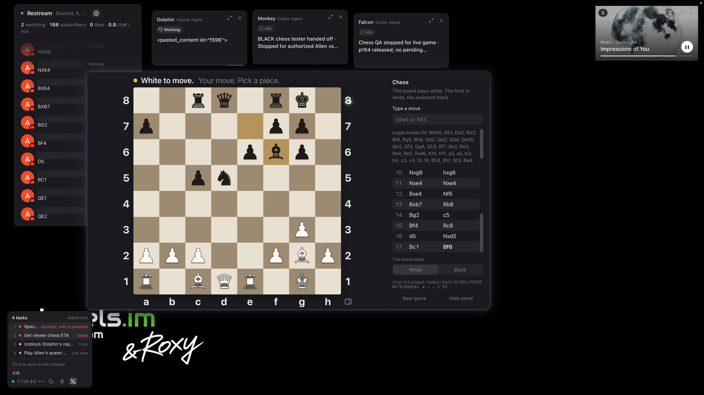

# Chess

Chess for two inside Wonop. The host plays one side on the board window, and
the assistant plays the other through commands. The full rules are enforced:
check, checkmate, stalemate, castling, promotion, en passant, and automatic
draws by threefold repetition, the fifty-move rule and insufficient material.
An illegal move is refused with a reason and the game does not change.

There is one game per workspace. It is saved after every move, and comes
back as it was when Wonop is closed and opened again.



*A live stream in Wonop. On the left, the Restream chat: a YouTube viewer
sends White's moves from the stream chat (their handle is blurred). In the
middle, the board, with the moves played and White's legal moves in the
panel. Roxy, the workbench assistant, plays Black through the commands below.*

## Install

Once it is listed in the Wonop Agent Store, install Chess from there. Until
then, once this repository is public, it installs straight from it in the
§ console:

```ts
await wm.store.installFromGit("https://github.com/wonop-io/one-up-chess.git");
```

## Playing on the board

- **Mouse.** Click one of your pieces. Its legal squares are marked: a dot
  for a move, a ring for a capture. Click a marked square to move.
- **Keyboard.** Tab into the board. The arrow keys move between squares,
  Enter or Space picks a piece up and puts it down, and Escape cancels.
- **Typing.** Open the panel with the button at the bottom right of the
  board. Type a move such as `e2e4` or `Nf3` and press Enter.
- **Promotion.** A pawn that reaches the last rank asks which piece it becomes.
- **Which side.** A board plays the host's side. To play the other side from
  this window, choose it under "This board plays" in the panel. A move for
  the side that is not to move is refused.

- **Replay.** "Replay game" in the panel shows the whole game again from the
  first move, one half-move a second, then returns to the game. Escape or a
  click on the board stops it. A replay only changes what the window shows:
  the game itself is not touched, and moves still arrive while it runs.

Every square has a spoken name, such as "e4, white knight, legal move".
Moves are announced as they happen. The panel also lists the legal moves for
the side this board plays, and the position as FEN.

## Playing as an agent

The typed interface is in [`chess-api.d.ts`](chess-api.d.ts). From the
§ console or an agent script:

```ts
const chess = wm.apps["two-player-game"];

const s = await chess.state();
// s.turn === "black", s.legalMoves = [{ uci: "e7e5", san: "e5" }, …]

await chess.move({ move: "e7e5", side: "black" });   // UCI
await chess.move({ move: "Nf6", side: "black" });    // or SAN

try {
  await chess.move({ move: "e8g8", side: "black" });
} catch (e) {
  // e.code === "invalid_args" or "forbidden"
  // e.message: "Black cannot castle while pieces stand between the king and the rook."
  // The game is unchanged.
}
```

Coding agents get the same commands as the MCP tools
`two-player-game-state`, `-legalMoves`, `-move`, `-newGame`, `-loadFen` and
`-resign`.

| Command | Does |
|---|---|
| `state()` | the game: whose turn, status, board, FEN, moves played, every legal move |
| `legalMoves({ square? })` | legal moves for the side to move, or only from one square |
| `move({ move, side? })` | plays UCI or SAN; with `side`, refuses it on the other side's turn |
| `newGame({ hostSide? })` | starts again; `hostSide` is the side the board window plays |
| `loadFen({ fen, hostSide? })` | starts from a position, for testing a rule |
| `resign({ side })` | ends the game for one side |
| `replay({ delayMs? })` | shows the game move by move in the board window (1000 ms per half-move), then the live position; changes nothing |
| `stopReplay()` | stops a replay |
| `previousGames()` | the last five games a new game replaced, as PGN |

A reliable loop for an agent: read `state()`, wait while `turn` is not your
side, choose a move from `legalMoves`, and send it with `side` set. Each move
is also emitted on the `moves` output as a line, for example "White played e4".

## Saving

The game is kept in Wonop's package storage (`app.store`) after every move:
its starting position, every move, which side the board plays and any
resignation. It survives a reload, quitting Wonop and an update.

On opening, nothing saved is trusted as it stands. The moves are replayed
from the starting position and each one is checked. If a move no longer
replays, the moves before it are kept, the window says so, and the saved
copy is kept aside rather than lost. A new game puts the old one aside too:
`previousGames()` lists the last five.

## Developing

`deno task ci` runs the tests and the API check. The tests include perft
counts against known reference values, which check the move generator
exactly.

## Licence

MIT. See [LICENSE](LICENSE).
